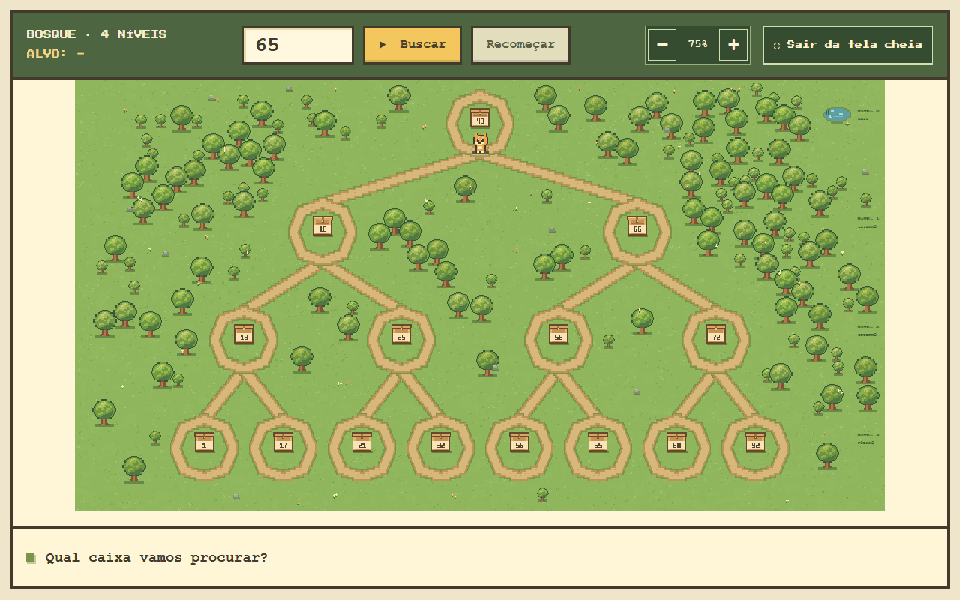

<h1 align="center">O Gato e o Atum</h1>

<p align="center">
  Uma busca em árvore B com pixel art:<br>
  o gato percorre o bosque, encontra a caixa numerada e pega o peixe.
</p>

<p align="center">
  
  
  
</p>

---

## Demonstração

<p align="center">
  
</p>

## Sobre o projeto

Trabalho de **Estruturas de Dados 2 (2026.2)** da **Universidade de Brasília - FCTE**.

O bosque tem **15 caixas**, uma por nó, organizadas em uma **árvore B com quatro níveis**. Cada caixa recebe um número diferente de **1 a 100**. O gato segue os passos reais da busca e abre a caixa correta.

Se o número não existir, ele substitui o mais próximo e a árvore é reorganizada. A busca continua com o número digitado.

## Integrantes

<div align="center">

| [](https://github.com/arthurrochamoreira) | [](https://github.com/dev-LucasDpaula) |
| :---: | :---: |
| **Arthur Moreira** | **Lucas D. Paula** |
| 21/1030658 | 24/1011386 |

</div>

## Como usar

1. Digite um número e clique em **Buscar**, ou clique em uma caixa.
2. Acompanhe o gato até ele abrir a caixa e pegar o peixe.
3. Use **− / +** para ajustar o zoom e **Tela cheia** para ampliar a visão.
4. Clique em **Recomeçar** para renovar o bosque com 15 números novos de 1 a 100.

## Como executar

Requer **Node.js 18+**.

```bash
git clone https://github.com/eda2-2026/G14_Arvores_EDA2-2026.2.git
cd G14_Arvores_EDA2-2026.2
npm start
```

Abra [localhost:8000](http://localhost:8000) no navegador.

## Estrutura

```text
├── index.html          # Tela do jogo
├── src/arvore-b.js     # Algoritmo e estrutura da árvore
├── src/interface/      # Cenário, caminhos e animações
├── scripts/           # Servidor local
└── tests/             # Testes da árvore e do bosque
```

## Testes

```bash
npm test
```

---

<p align="center">
  <sub>Grupo 14 · Estruturas de Dados 2 · 2026.2</sub>
</p>
